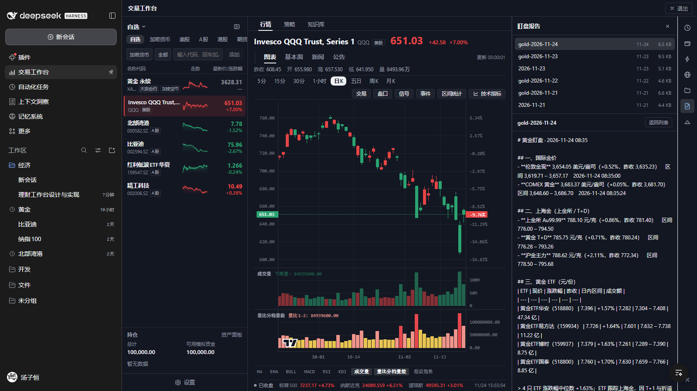
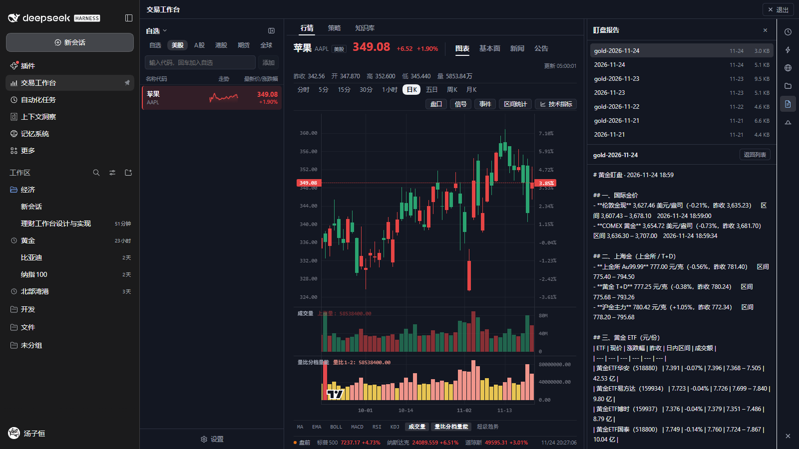

# dsh-trade · 交易工作台

把 [dsh-trading](https://github.com/zhu1090093659/dsh-trading) 的三栏交易界面，做成 **DeepSeek Harness 客户端左侧导航行 + 全页面板**。

点左侧栏「交易工作台」，整页打开：左列自选（分组 / 市场页签 / 行内迷你走势）、中栏行情（日K / 分时 / 盘口 / 信号 / 事件 / 区间统计 / 技术指标 / 策略 / 知识库）、右列盯盘报告，最右侧 44px 竖条切换面板（定时任务 / 快讯 / 宏观 / 文件 / 盯盘报告 / 预测市场 / 回到对话）。



## 特性

- **一个插件、一个入口**：9 个上游 bundle（base / bot-api / cn / us / hk / futures / global / gui / …）的 55 行 patch 合并进本包的 `cordis.patch.yml`，插件列表里只留 `dsh-trading-panel` 一行。
- **导航行 + main 面板**：`sidebar.panellist` 注册入口图标，`main` 注册整页；不占用 `shell.overlay`，与宿主侧栏、宿主自己的面板互不重叠。
- **三列可拖宽**：左栏 200–560px、右列 260–860px，拖手柄实时预览，中栏保底 380px；宽度记 `localStorage`，双击手柄复位。
- **当日分时图**：1m 数据按市场本地交易日切片，面积线（涨红跌绿）+ 成交额加权均价线 + 昨收虚线，5s 轮询，legend 显示现价/涨跌幅/均价/昨收/实时。
- **盯盘报告**：右列默认自动打开工作区 `reports/watch/` 下的最新报告，点条目左列可切到文件面板预览。
- **文件面板**：宿主半提供 `/dshtrading-panel/api/files`（列目录 / 读文本 / 列报告），root 取 `DSH_TRADING_FILES_ROOT` → 最近更新的 DSH 工作区 → cwd。
- **美股靠本地代理**：Yahoo 对国内直连返回 403，宿主半启动时探活本地代理（`DSHTRADING_PROXY` / `HTTPS_PROXY` / 默认 `http://127.0.0.1:12450`），可达则把**外网** fetch 交给 `undici` 的 `ProxyAgent`，回环地址仍直连。



## 安装

前提：DeepSeek Harness 桌面端（0.2.2-rc.3 起），`@dshtrading/*` 走公开 npm 的 **0.7.1**（0.8.0 要 dsh ≥ 0.2.2-rc.5，会被版本闸门拦住）。

```bash
# 1. 装上游运行时包（连接器 / 账本 / 桥）
DSH_HOME=~/.dsh dsh plugin --profile desktop add \
  @dshtrading/base@0.7.1 @dshtrading/bot-api@0.7.1 @dshtrading/cn@0.7.1 \
  @dshtrading/us@0.7.1 @dshtrading/hk@0.7.1 @dshtrading/futures@0.7.1 \
  @dshtrading/global@0.7.1 @dshtrading/gui@0.7.1

# 2. 装本插件（仓库里带构建产物 lib/，装完即可用）
git clone https://github.com/FlowerSea111222/dsh-trade.git
DSH_HOME=~/.dsh dsh plugin --profile desktop add "file:$PWD/dsh-trade"
```

顺序很重要：`bundles` 数组里本插件必须排在 `@dshtrading/gui` **之后**（patch 按行 id 整行替换 GUI 的壳行）。装完重启 DeepSeek Harness，左侧栏「交易工作台」在「插件」与「自动化任务」之间。

卸载：从 `~/.dsh/profiles/desktop/package.json` 的 `dsh.profile.bundles` 删掉这些行即可。

## 从源码构建

```bash
pnpm install
pnpm build                 # tsdown：src/index.ts → lib/index.mjs；src/client/index.tsx → lib/client.js
node scripts/deploy.mjs    # 构建 + 同步 lib/ 到 ~/.dsh/profiles/desktop/node_modules/dsh-trading-panel/lib
node scripts/deploy.mjs --profile=trading-desktop   # 另一个 profile
```

profile 里是**实目录拷贝**（不是软链），改完必须同步再重启宿主——客户端 bundle 只在宿主启动时装配，刷新页面不生效。

## 目录结构

```
src/
  index.ts             宿主半：文件/报告 API + 外网代理引导（installProxyFetch）
  client/              浏览器半：TradingPage（三列壳）、TradingRow（导航行图标）、
                       FilesPanel、ReportsPanel、LeftPositions
  trading/             上游 0.7.1 客户端源码（22k 行，见「许可」）
    MarketSidebar.tsx  左列自选（新增 belowList 插槽）
    QuoteStage.tsx     中栏行情（新增分时周期、去掉下单台）
    IntradayChart.tsx  当日分时图
    …
scripts/deploy.mjs     构建 + 同步 + 字节校验
cordis.patch.yml       55 行上游 patch + 1 行壳行替换
```

## 与上游的差异

| 上游 | 这里 |
| --- | --- |
| `shell.overlay` 接管宿主栅格（左停靠 + 中栏 + 右缘竖条） | `sidebar.panellist` + `main` 整页面板，普通流布局，不与宿主侧栏重叠 |
| 14 个 bundle 分别安装 | 合并成 1 个，55 行 patch 内联 |
| 含加密货币（binance/okx/bybit/ccxt） | 已移除（`merge_patch.py` 的 ORDER 去掉 crypto） |
| 含持仓 / 下单台 | 已移除（持有 `paperTradingStore` 的组件被 tree-shake，client.js 2.06MB → 1.20MB） |
| Yahoo 直连 | 外网走本地代理（可关：不设代理时行为不变） |

## 已知限制

- **美股需要本地代理**（Yahoo 地域封锁）；A 股 / 港股 / 期货走腾讯、同花顺等国内源，不需要。
- **金十 MCP Token** 缺失时「宏观」「快讯」显示数据源不可用（BYOK：设置中心 `dshtrading.credentials.jin10.token` 或环境变量 `JIN10_MCP_TOKEN`）。
- **美股自选列表为空**：Yahoo 无代码表，`/symbols?market=us` 返回空数组，需在输入框手动敲代码（如 `AAPL`）。
- 面板模式没有宿主对话列——宿主 `renderSlot('main', {…}, { entryKey: panelId ?? 'conversation' })` 的语义决定，选中全局面板时对话整体不挂载。

## 许可

- 本仓库的胶水代码（`src/index.ts`、`src/client/`、`scripts/`、`cordis.patch.yml`）：MIT。
- `src/trading/` 与 `lib/` 中的上游派生代码来自 [zhu1090093659/dsh-trading](https://github.com/zhu1090093659/dsh-trading) v0.7.1，遵循 **PolyForm Noncommercial License 1.0.0**（仅限非商业用途），原文见 [LICENSE.upstream](LICENSE.upstream)。二次分发请保留该许可与署名。
- 行情数据版权归各数据源（腾讯 / Yahoo / 同花顺 / 金十 / Polymarket）所有，本项目只做本地展示，不再分发。
